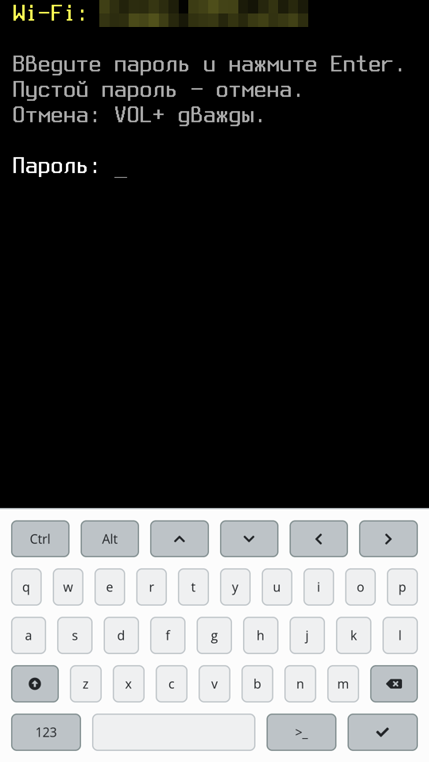
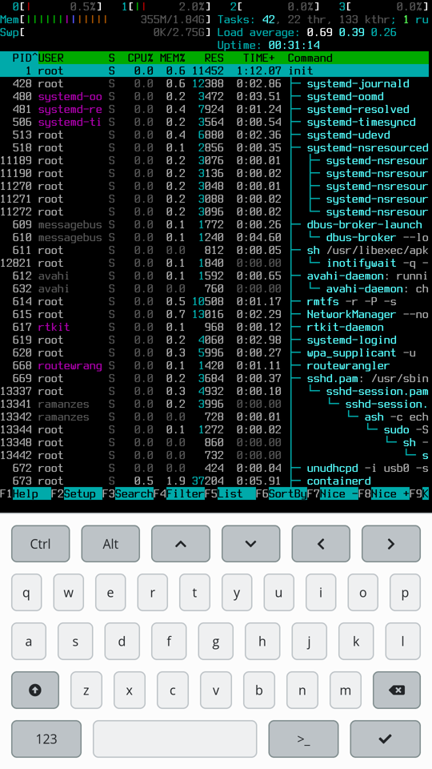

# nura-server-shell

Серверная оболочка для старого смартфона на **Nura** (бывший postmarketOS): вместо графического интерфейса — текстовое табло состояния, управление кнопками громкости и касанием, RGB-светодиод состояния. Телефон работает как маленький сервер (Docker, туннель dix.su), а на экране видно главное: Wi-Fi, интернет, контейнеры, батарея, температура.

Графика (Phosh) на этих устройствах не нужна и бывает нестабильной; оболочка рисует через консоль ядра (fbcon) и не использует GPU.

| Табло | Меню | Выбор сети Wi-Fi | Пароль Wi-Fi | htop с клавиатурой |
|---|---|---|---|---|
|  |  |  |  |  |

## Возможности

- **Табло** (tty1): имя устройства, время работы, пользователь, свободное место, Wi-Fi (сеть, сигнал, IP), шлюз и интернет (`OK` / `LOSS` / `FAIL`), USB-сеть, контейнеры Docker, батарея и зарядка, температура CPU, память, яркость. Обновляется каждые 10 секунд, экран гаснет через минуту.
- **Светодиод состояния**: зелёная вспышка раз в 5 с — всё в порядке; жёлтая раз в 2 с — батарея < 20 % без зарядки; красная раз в секунду — нет Wi-Fi / шлюза / интернета, упал контейнер или CPU ≥ 75 °C (держится больше 20 с).
- **htop** во весь экран: прокрутка кнопками громкости, а с экранной клавиатурой (или USB-клавиатурой через OTG) — все команды htop: завершить процесс, приоритет, поиск, фильтр, дерево, сортировка.
- **Консоль** со входом в систему и экранной клавиатурой (buffyboard).
- **Меню действий**: подключить к Wi-Fi, перезапустить контейнеры, переподключить Wi-Fi, перезагрузить, выключить. Выбор кнопками громкости, выполнение касанием, опасные действия — с подтверждением.
- **Подключение к новой сети Wi-Fi без ПК**: поиск сетей, выбор касанием, ввод пароля с экранной клавиатуры. Для покупателя устройства, у которого дома другая сеть.

## Управление

| Кнопки | Действие |
|---|---|
| VOL+ / VOL− | яркость (в htop — прокрутка, в меню — выбор пункта) |
| VOL+ и VOL− вместе | табло ⇄ htop |
| VOL− дважды в htop | показать / спрятать экранную клавиатуру |
| VOL− дважды | консоль ⇄ табло (кроме режима htop) |
| VOL+ дважды | меню ⇄ табло (и отмена ввода пароля Wi-Fi) |
| касание пункта меню | выполнить |
| POWER коротко | включить погасший экран |
| POWER 5 секунд | перезагрузка |

Удалённо, по SSH:
```sh
sudo systemctl kill --kill-whom=main -s USR1 nura-keys   # = VOL+ и VOL- (htop)
sudo systemctl kill --kill-whom=main -s USR2 nura-keys   # = VOL- дважды (консоль)
sudo systemctl kill --kill-whom=main -s HUP  nura-keys   # = VOL+ дважды (меню)
```

## Установка

На телефоне с Nura / postmarketOS (systemd), по SSH:
```sh
wget -qO- https://raw.githubusercontent.com/ramanzes/nura-server-shell/main/install.sh | sudo sh
```
Если стоит графический интерфейс (Phosh и т. п.) и его нужно отключить, чтобы табло заняло экран:
```sh
wget -qO- https://raw.githubusercontent.com/ramanzes/nura-server-shell/main/install.sh | sudo sh -s -- --headless
```
Или из клона:
```sh
git clone https://github.com/ramanzes/nura-server-shell.git && cd nura-server-shell && sudo ./install.sh
```
Установщик ставит пакеты (`python3 iw htop buffyboard kbd font-terminus networkmanager-cli` — все из репозиториев Alpine), копирует скрипты и службы, освобождает tty2–tty5 и запускает оболочку. Старая версия со скриптами `bacon-*` удаляется автоматически.

**Обновление** — та же команда установки. **Удаление**: `sudo ./uninstall.sh` (с `--restore-gui` — вернуть графику).

## Устройства

Проверено:

| Устройство | Порт Nura | Особенности |
|---|---|---|
| OnePlus One | `oneplus-bacon` (armv7) | светодиод — три канала (SN3193), иногда не отвечает при загрузке: оболочка переподключает драйвер сама |
| Google Nexus 5 | `lg-hammerhead` (armv7) | многоцветный светодиод `rgb:status`; ядро в раздел boot — см. ниже |

Требования: экран через `msm` DRM / fbdev **1080×1920** (разметка меню рассчитана на это разрешение), кнопки `gpio-keys`, тачскрин Synaptics (RMI4), подсветка `/sys/class/backlight/lcd-backlight`, NetworkManager.
Батарея и светодиод определяются автоматически.

Для Nexus 5 без lk2nd полезно включить запись нового ядра в раздел boot при обновлении (иначе после `apk upgrade` пропадёт Wi-Fi):
```sh
echo 'deviceinfo_flash_kernel_on_update="true"' | sudo tee /etc/deviceinfo && sudo mkinitfs
```

### htop с клавиатурой

В htop нажмите **VOL− дважды** — снизу появится экранная клавиатура, htop ужмётся по высоте. Основные клавиши htop: `k` — завершить процесс (сигнал выбирается стрелками, Enter), `/` — поиск, `\` — фильтр, `t` — дерево процессов, `u` — процессы пользователя, `P` / `M` / `T` — сортировка по CPU / памяти / времени, `]` / `[` — приоритет, `S` — настройка, `h` — справка, `q` — выход на табло. Стрелки — на верхнем ряду клавиатуры. Кнопки громкости по-прежнему листают список.

## Состав

```
bin/nura-status        табло на tty1 и светодиод (sh)
bin/nura-keys          кнопки, тачскрин, htop, консоль, меню, Wi-Fi (python3)
bin/nura-wifi-join     ввод пароля и подключение к новой сети (sh, tty5)
systemd/*.service      службы
config/htoprc          колонки htop под экран телефона
config/50-nura-powerkey.conf   logind: POWER коротко — ничего, 5 с — перезагрузка
install.sh, uninstall.sh
```

## Лицензия

Двойная лицензия — по вашему выбору **Apache License 2.0** ([LICENSE-APACHE](LICENSE-APACHE)) или **GNU GPL v3** ([LICENSE-GPL3](LICENSE-GPL3)).
`SPDX-License-Identifier: Apache-2.0 OR GPL-3.0-only`
