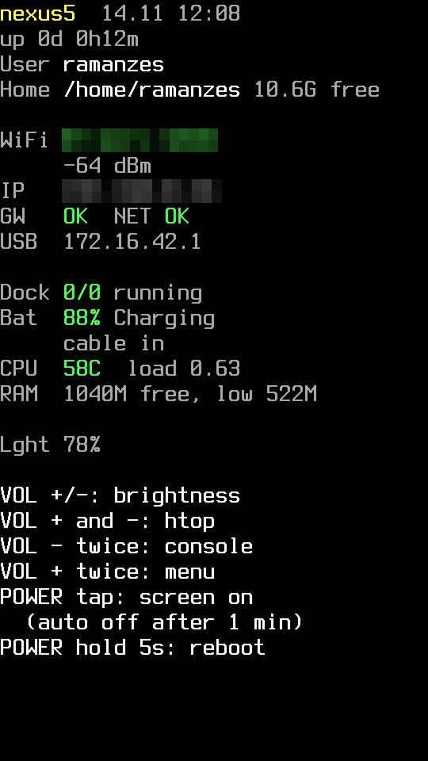
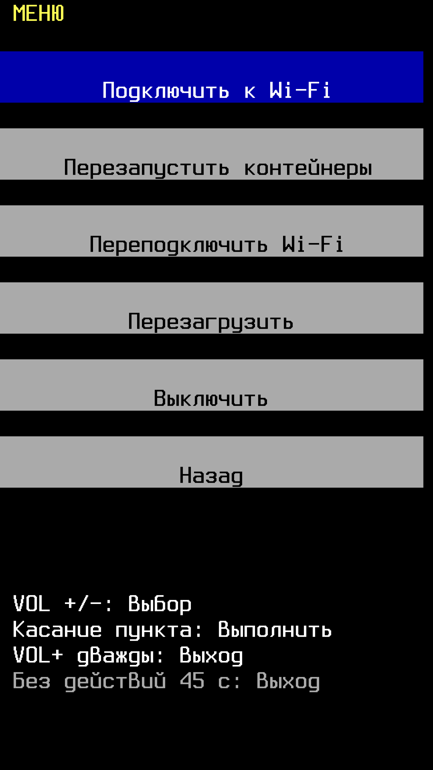
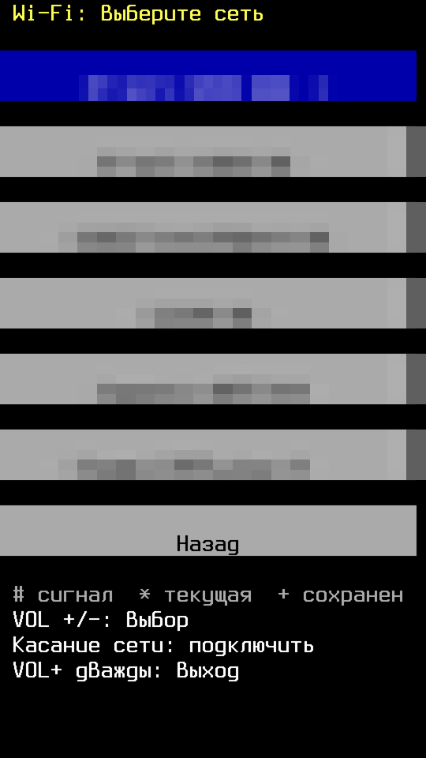
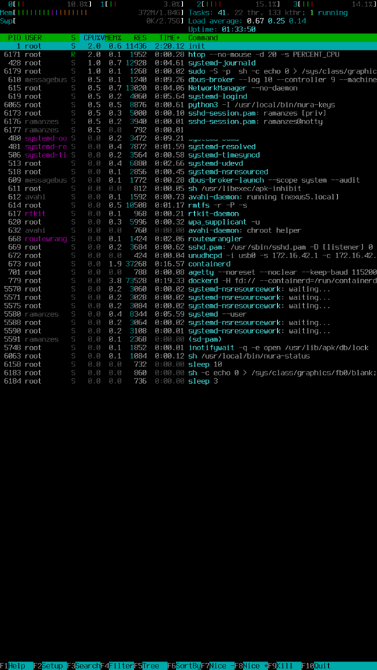

# nura-server-shell

Серверная оболочка для старого смартфона на **Nura** (бывший postmarketOS): вместо графического интерфейса — текстовое табло состояния, управление кнопками громкости и касанием, RGB-светодиод состояния. Телефон работает как маленький сервер (Docker, туннель dix.su), а на экране видно главное: Wi-Fi, интернет, контейнеры, батарея, температура.

Графика (Phosh) на этих устройствах не нужна и бывает нестабильной; оболочка рисует через консоль ядра (fbcon) и не использует GPU.

| Табло | Меню | Выбор сети Wi-Fi | Пароль Wi-Fi | htop | htop с клавиатурой |
|---|---|---|---|---|---|
|  |  |  |  |  |  |

## Возможности

- **Табло** (tty1): имя устройства, время работы, пользователь, свободное место, Wi-Fi (сеть, сигнал, IP), шлюз и интернет (`OK` / `LOSS` / `FAIL`), USB-сеть, контейнеры Docker, батарея и зарядка, температура CPU, память, яркость. Обновляется каждые 10 секунд, экран гаснет через минуту.
- **Светодиод состояния**: зелёная вспышка раз в 5 с — всё в порядке; жёлтая раз в 2 с — батарея < 20 % без зарядки; красная раз в секунду — нет Wi-Fi / шлюза / интернета, упал контейнер или CPU ≥ 75 °C (держится больше 20 с).
- **htop** во весь экран: прокрутка кнопками громкости, а с экранной клавиатурой (или USB-клавиатурой через OTG) — все команды htop: завершить процесс, приоритет, поиск, фильтр, дерево, сортировка.
- **Консоль** со входом в систему и экранной клавиатурой (buffyboard).
- **Меню действий**: подключить к Wi-Fi, ориентация htop и консоли, перезапустить контейнеры, переподключить Wi-Fi, перезагрузить, выключить. Выбор кнопками громкости, выполнение касанием, опасные действия — с подтверждением.
- **Подключение к новой сети Wi-Fi без ПК**: поиск сетей, выбор касанием, ввод пароля с экранной клавиатуры. Для покупателя устройства, у которого дома другая сеть.

## Блокировка экрана

Это сервер, поэтому оболочка закрыта паролем: **при включении телефона, при каждом гашении экрана и по короткому нажатию питания** появляется экран блокировки. До ввода пароля недоступны табло, htop (работает от root), меню (перезагрузка, Wi-Fi), консоль.

- Пароль — **системный пароль основного пользователя** (первый с UID 10000…59999; другого можно задать в `/etc/nura-server-shell.conf`, `LOCK_USER=`). Проверяет `unix_chkpwd` из Linux-PAM, оболочка паролей не хранит.
- Ввод — с экранной клавиатуры buffyboard (или USB-клавиатуры через OTG), символы показываются звёздочками.
- На экране блокировки только имя устройства, время и общее состояние («в порядке / предупреждение / проблема») — без IP, сетей и контейнеров. Светодиод состояния работает как обычно.
- Защита от подбора: пауза 2 с после ошибки, после 5 ошибок подряд — 5 минут ожидания; счётчик хранится на диске и не сбрасывается перезапуском службы; каждая попытка пишется в журнал.
- Обходы закрыты: на время блокировки запрещено переключение консолей (`VT_LOCKSWITCH` — ни Alt+F1, ни `chvt`), сигналы `nura-ctl` игнорируются (кроме `unlock`), SysRq выключен (`kernel.sysrq = 0`).
- Кнопки громкости на экране блокировки меняют только яркость.
- Администратор по SSH: `sudo nura-ctl lock` — заблокировать, `sudo nura-ctl unlock` — разблокировать без пароля (например, если пароль забыт).
- Отключить блокировку: `LOCK=0` в `/etc/nura-server-shell.conf` и перезапуск `nura-keys`.

## Управление

| Кнопки | Действие |
|---|---|
| VOL+ / VOL− | яркость (в htop — прокрутка, в меню — выбор пункта) |
| VOL+ и VOL− вместе | табло ⇄ htop |
| VOL− дважды в htop | показать / спрятать экранную клавиатуру |
| VOL− дважды | консоль ⇄ табло (кроме режима htop) |
| VOL+ дважды | меню ⇄ табло (и отмена ввода пароля Wi-Fi) |
| касание пункта меню | выполнить |
| касание строки F1…F10 внизу htop | нажать эту F-клавишу |
| POWER коротко | погасить экран и заблокировать; на погасшем — включить экран |
| POWER 5 секунд | перезагрузка |

Удалённо, по SSH (systemd и OpenRC):
```sh
sudo nura-ctl top       # = VOL+ и VOL- вместе (табло <-> htop)
sudo nura-ctl console   # = VOL- дважды (консоль; в htop — экранная клавиатура)
sudo nura-ctl menu      # = VOL+ дважды (меню)
sudo nura-ctl lock      # заблокировать экран
sudo nura-ctl unlock    # снять блокировку без пароля
```

## Установка

На телефоне с Nura / postmarketOS (systemd или OpenRC), по SSH:
```sh
wget -qO- https://raw.githubusercontent.com/ramanzes/nura-server-shell/main/install.sh | sudo sh
```
Если стоит графический интерфейс (Phosh и т. п.) и его нужно отключить, чтобы табло заняло экран:
```sh
wget -qO- https://raw.githubusercontent.com/ramanzes/nura-server-shell/main/install.sh | sudo sh -s -- --headless
```
Или из клона:
```sh
git clone https://github.com/ramanzes/nura-server-shell.git && cd nura-server-shell && sudo ./install.sh
```
Если работает графический интерфейс, установщик без `--headless` только раскладывает файлы и **не запускает** оболочку — она мешала бы графике (кнопки, экран).
Установщик ставит пакеты (`python3 iw htop buffyboard kbd font-terminus networkmanager-cli` — все из репозиториев Alpine), копирует скрипты и службы, освобождает tty2–tty5 и запускает оболочку. Старая версия со скриптами `bacon-*` удаляется автоматически.

**Обновление** — та же команда установки. **Удаление**: `sudo ./uninstall.sh` (с `--restore-gui` — вернуть графику).

## Устройства

Проверено:

| Устройство | Порт Nura | Особенности |
|---|---|---|
| OnePlus One | `oneplus-bacon` (armv7) | светодиод — три канала (SN3193), иногда не отвечает при загрузке: оболочка переподключает драйвер сама |
| Google Nexus 5 | `lg-hammerhead` (armv7) | многоцветный светодиод `rgb:status`; ядро в раздел boot — см. ниже |
| Xiaomi Redmi Note 7 | `xiaomi-lavender` (aarch64, **OpenRC**) | экран 1080×2340, VOL− на `pm8941_resin`, тачскрин Novatek, подсветка 0–4095, белый светодиод (состояние — частотой вспышек); **альбомная ориентация работает** |

Требования: Nura / postmarketOS с **systemd или OpenRC**, экран через fbdev (`/dev/fb0`), кнопки громкости, мультитач-тачскрин, NetworkManager.
Железо определяется автоматически: размер экрана (`/sys/class/graphics/fb0/modes`), подсветка (первая в `/sys/class/backlight`, яркость в процентах от максимума), кнопки громкости (все устройства с `KEY_VOLUMEUP/DOWN` — они могут быть на разных), тачскрин (устройство с `ABS_MT_POSITION_X`), светодиод (`rgb:status`, `red/green/blue:status` или `white:status`), батарея и зарядка.

На OpenRC установщик ставит службы в `/etc/init.d`, убирает `getty` с tty1–tty5 в `/etc/inittab` (вход остаётся на tty6) и настраивает кнопку питания для elogind.

Для Nexus 5 без lk2nd полезно включить запись нового ядра в раздел boot при обновлении (иначе после `apk upgrade` пропадёт Wi-Fi):
```sh
echo 'deviceinfo_flash_kernel_on_update="true"' | sudo tee /etc/deviceinfo && sudo mkinitfs
```

### htop с клавиатурой

В htop нажмите **VOL− дважды** — снизу появится экранная клавиатура, htop ужмётся по высоте. Функциональных клавиш на экранной клавиатуре нет — **касайтесь подписей в нижней строке htop** (`F1Help` … `F10Quit`): касание отправляет соответствующую F-клавишу. В портретной ориентации htop использует шрифт 12×24 (90 колонок), чтобы строка F1…F10 помещалась целиком. Основные клавиши htop: `k` — завершить процесс (сигнал выбирается стрелками, Enter), `/` — поиск, `\` — фильтр, `t` — дерево процессов, `u` — процессы пользователя, `P` / `M` / `T` — сортировка по CPU / памяти / времени, `]` / `[` — приоритет, `S` — настройка, `h` — справка, `q` — выход на табло. Стрелки — на верхнем ряду клавиатуры. Кнопки громкости по-прежнему листают список.

### Ориентация htop и консоли

Пункт меню «Ориентация htop/консоли» переключает портретную и альбомную (120 колонок) ориентацию для htop и консоли; настройка сохраняется в `/var/lib/nura-server-shell/rotate`. Экранная клавиатура поворачивается вместе с текстом. Табло и меню остаются портретными.
Поворот требует опции ядра `CONFIG_FRAMEBUFFER_CONSOLE_ROTATION=y`. В ядре msm8974 (OnePlus One, Nexus 5) она выключена — пункт сообщит об этом; в ядре sdm660 (Xiaomi Redmi Note 7) включена: там htop в альбомной ориентации — 146 колонок, касания строки F1…F10 и клавиатура поворачиваются вместе с текстом.

## Состав

```
bin/nura-status        табло на tty1 и светодиод (sh)
bin/nura-keys          кнопки, тачскрин, htop, консоль, меню, Wi-Fi (python3)
bin/nura-wifi-join     ввод пароля и подключение к новой сети (sh, tty5)
bin/nura-ctl           удалённое управление: top | console | menu
systemd/*.service      службы systemd
openrc/*               службы OpenRC (supervise-daemon)
config/htoprc          колонки htop под экран телефона
config/50-nura-powerkey.conf   logind: POWER коротко — ничего, 5 с — перезагрузка
install.sh, uninstall.sh
```

## Лицензия

**GNU General Public License v3.0 или более поздняя версия** — см. [LICENSE](LICENSE). `SPDX-License-Identifier: GPL-3.0-or-later`

```
nura-server-shell — серверная оболочка для телефонов на Nura
Copyright (C) 2026 ramanzes

Это свободная программа: вы можете распространять и/или изменять её
на условиях GNU General Public License, опубликованной Free Software
Foundation, версии 3 либо (по вашему выбору) любой более поздней версии.
Программа распространяется БЕЗ КАКИХ-ЛИБО ГАРАНТИЙ. Подробности — в GNU GPL.
```

Можно свободно использовать, изменять и распространять, в том числе на продаваемых устройствах, при условии, что изменённая версия тоже распространяется под GPL с открытым исходным кодом.
